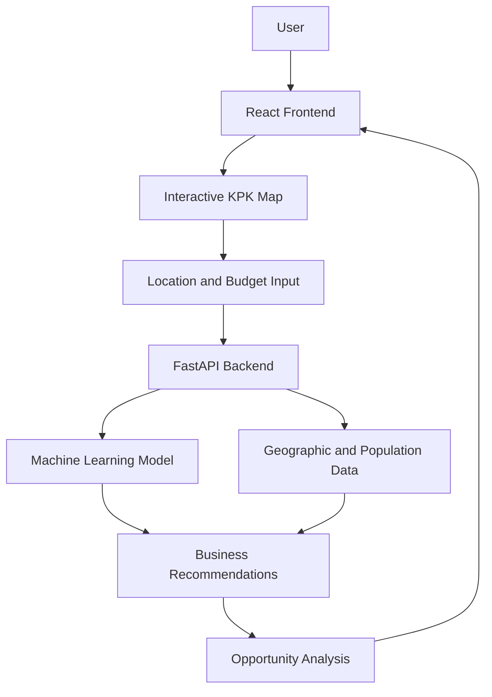

# AI Business Location & Opportunity Advisor

**An AI-powered business intelligence platform for discovering promising business opportunities across Khyber Pakhtunkhwa (KPK), Pakistan.**

This project combines machine learning, geographic data, and interactive maps to help users explore business locations and make data-informed decisions.

## Project Overview

Users can select a location on the KPK map, enter their available budget, and receive business recommendations with supporting opportunity analysis.

## Key Features

- **Interactive KPK Map:** Explore districts and select business locations.
- **AI-Powered Recommendations:** Generate business suggestions using a trained machine learning model.
- **Budget Compatibility:** Evaluate opportunities according to the available budget.
- **Opportunity Scoring:** Present an opportunity score to support decision-making.
- **Competition Analysis:** Provide insights into business competition.
- **Risk Assessment:** Help users understand potential business risks.
- **Geographic Data Integration:** Use KPK district boundaries and population datasets.
- **Backend API:** Connect the React frontend with the FastAPI backend.

## Technology Stack

| Component | Technologies |
|---|---|
| Frontend | React.js, Vite, CSS |
| Backend | Python, FastAPI |
| Machine Learning | Python, trained ML model |
| Geographic Visualization | React Leaflet, GeoJSON |
| Data Processing | Python, Pandas, CSV |
| Development Tools | Git, GitHub, VS Code |

## System Architecture



## Project Structure

```text
AI-Business-Advisor/
|
|-- backend/
|   |-- app.py
|   |-- train_business_model.py
|   |-- requirements.txt
|   |-- business_model.pkl
|   |-- business_data.pkl
|
|-- data/
|   |-- boundaries/
|   |-- population/
|
|-- frontend/
|   |-- public/
|   |-- src/
|   |-- package.json
|   |-- vite.config.js
|
|-- model/
|-- mobile/
|-- docs/
|-- START.bat
|-- .gitignore
|-- README.md
```

## Installation & Setup

### Prerequisites

- Python installed and compatible with the backend dependencies.
- Node.js and npm.
- Git.

### 1. Clone the Repository

```bash
git clone https://github.com/nasar-dataengineer/AI-Business-Advisor.git
cd AI-Business-Advisor
```

### 2. Setup Backend

Create a virtual environment:

```bash
python -m venv .venv
```

Activate it on Windows:

```powershell
.venv\Scripts\Activate.ps1
```

Install dependencies:

```bash
pip install -r backend/requirements.txt
```

### 3. Setup Frontend

```bash
cd frontend
npm install
cd ..
```

### 4. Run the Application

On Windows, run:

```powershell
.\START.bat
```

The application starts the following services:

| Service | Local URL |
|---|---|
| FastAPI Backend | http://127.0.0.1:8000 |
| Vite Frontend | http://127.0.0.1:5173 |

Open the frontend URL in your browser.

## How It Works

1. Open the application.
2. Explore the interactive KPK map.
3. Select a location within a KPK district.
4. Enter your available business budget.
5. Submit the analysis request.
6. Review business recommendations and opportunity insights.

## API Configuration

During development, the frontend uses `/api` for backend requests. Vite proxies these requests to FastAPI.

To use a different backend address, configure:

```env
API_PROXY_TARGET=http://127.0.0.1:8000
```

For a frontend deployment without the Vite development proxy, configure:

```env
VITE_API_URL=https://your-backend-domain.com
```

Replace the example domain with your actual backend address.

## Data Sources

The project uses geographic and population-related datasets, including:

- KPK district population data (2023).
- Pakistan administrative boundary datasets.
- KPK district GeoJSON boundaries.

## Current Development Status

The project includes:

- React-based interactive frontend.
- FastAPI backend.
- Trained machine learning model artifacts.
- KPK geographic data integration.
- Budget-based business analysis.
- Location-based recommendation workflow.

The mobile directory is reserved for future development.

## Future Improvements

- [ ] Deploy frontend and backend publicly.
- [ ] Develop a dedicated mobile application.
- [ ] Expand business datasets.
- [ ] Improve model evaluation and recommendation accuracy.
- [ ] Add advanced geographic analytics.
- [ ] Introduce user accounts and saved analyses.
- [ ] Add automated testing.

## Author

**Nasar Khan**

Software Engineering Student | AI & Data Science Enthusiast

GitHub: [@nasar-dataengineer](https://github.com/nasar-dataengineer)

---

*Built to support smarter, data-driven business decisions in Khyber Pakhtunkhwa, Pakistan.*